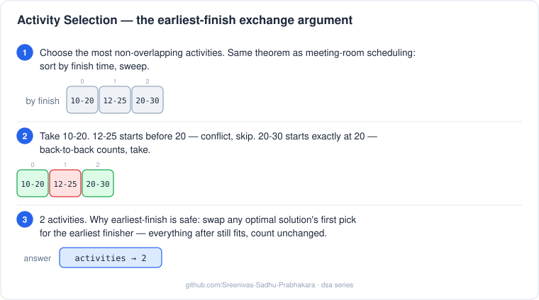

# Activity Selection

> Striver SDE Sheet 048 · Day 8 Greedy — the same earliest-finish greedy as N-meetings, but returning the chosen set, with touching intervals allowed. Go, stdlib only, tested.

## Problem

From a set of activities with start and finish times, select the largest possible subset with no overlaps. The sheet lists this beside N Meetings deliberately — same algorithm, two differences worth being precise about.

## Approach

Sort by finish time; accept whatever starts at or after the last accepted finish. Difference one: this variant treats half-open intervals, so an activity may begin exactly when the previous ends (`>=`), whereas the meetings problem demanded a strict gap (`>`). Difference two: this returns the actual chosen activities, not just their count — same greedy, different deliverable. The optimality proof is the standard exchange argument on the earliest finisher.

**Complexity:** O(n log n) time, O(n) space.

## Visual walkthrough

Read the picture top to bottom — each numbered frame is one moment of the algorithm
running on this repo's test example.

## Run

    go test ./...   # verify
    go run .        # demo

---

One of 191 repos solving Striver's SDE Sheet in Go — stdlib only, one problem per repo, every solution tested. Browse the set: [`dsa-*` repos](https://github.com/Sreenivas-Sadhu-Prabhakara?tab=repositories&q=dsa-&type=source).
